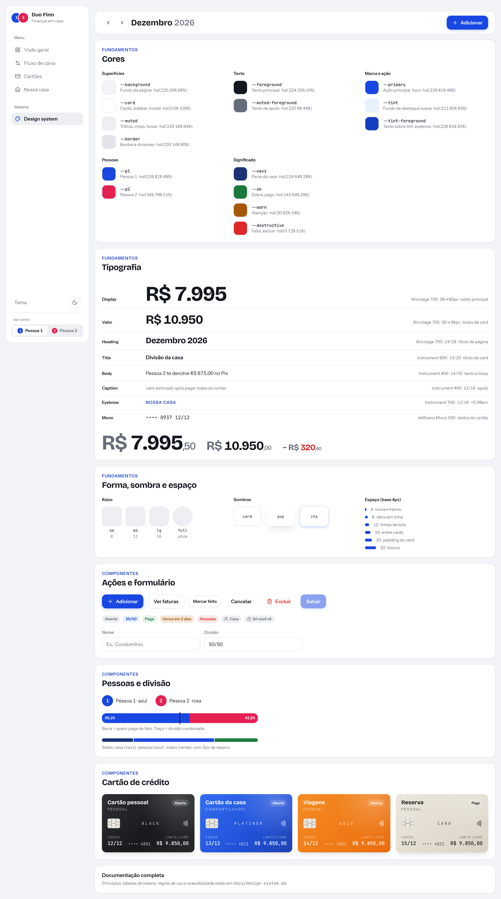

# Duo Finn — Design system

Referência viva: no app, **Sistema → Design system** (no celular: Casa → Dados → Design system).
Fonte da verdade dos tokens: `src/index.css` (valores) e `tailwind.config.js` (nomes).

## 1. De onde veio

Duas referências, com pesos diferentes:

| Referência | O que foi aproveitado |
| --- | --- |
| Mock do dashboard "Duo Finn" (print) | Estrutura: sidebar + cabeçalho com mês, cards brancos sobre fundo cinza-azulado, valor grande com `R$` e centavos apagados, barra segmentada do saldo, barra de divisão azul/rosa com traço do combinado, lista "quem paga cada conta" com acerto por Pix, chips de dia, cartão grafite. |
| visorfinance.app (site, medido no navegador) | Azul de ação `#1846e1`, fundo de destaque `#e8f3fe`, raios 12 / 16 / 20, pílulas 999, rótulo de seção em caixa alta com espaçamento (14px/700/+0,07em), sombra azul suave no botão principal, cinzas `#6c6e73` / `#e0e0e0` / `#f0f0f0`. |

O que **não** foi copiado, de propósito:

- **Fontes.** O site usa Satoshi e o mock usa uma grotesca tipo Inter. O pedido era evitar Inter; usamos Bricolage Grotesque (números e títulos) + Instrument Sans (texto).
- **Marca.** Nenhum logo, nome ou ilustração do Visor nem logos de bancos.
- **Ilustrações 3D** (carteira, balança, calendário): não temos esses assets. Não substituir por emoji.

## 2. Princípios

1. **O número é o herói.** Cada card tem um valor dominante; o resto é apoio em 12–14px.
2. **Cor tem dono.** Azul = Pessoa 1, rosa = Pessoa 2, em qualquer tela, independente de quem está olhando. Navy = casa, verde = sobra, vermelho = falta.
3. **Privado se parece com privado.** Tudo que só o dono vê leva cadeado; tudo que é da casa leva o ícone de pessoas. Valor do parceiro que não pode ser mostrado vira "privado", nunca `R$ 0,00`.
4. **Superfície calma.** Cards brancos, borda de 1px, sombra quase invisível. Cor forte só em dado e em ação principal (um botão azul por tela).
5. **Mobile primeiro.** Tudo funciona em 360px com uma coluna; colunas extras entram em `md` e `xl`.

## 3. Tokens

### 3.1 Cor

Valores em HSL, usados como `hsl(var(--token))`. Classe Tailwind = nome do token (`bg-primary`, `text-muted-foreground`, `bg-p1`…).

| Token | Claro | Escuro | Uso |
| --- | --- | --- | --- |
| `--background` | `220 20% 96%` | `224 20% 8%` | Fundo da página |
| `--card` | `0 0% 100%` | `224 18% 12%` | Cards, sidebar, modal, inputs |
| `--muted` | `220 16% 94%` | `224 14% 18%` | Trilhos de barra, chips, hover, blocos internos |
| `--border` | `220 14% 90%` | `224 12% 20%` | Bordas e divisores (sempre 1px) |
| `--foreground` | `224 25% 10%` | `220 15% 94%` | Texto principal |
| `--muted-foreground` | `220 9% 44%` | `220 9% 62%` | Texto de apoio, `R$` e centavos |
| `--primary` | `226 81% 49%` | `222 84% 55%` | Botão principal, foco, item ativo |
| `--tint` / `--tint-foreground` | `211 92% 95%` / `226 81% 42%` | `222 45% 18%` / `214 95% 78%` | Destaque suave (badge info, eyebrow) |
| `--p1` | `226 81% 49%` | `222 84% 55%` | Pessoa 1 |
| `--p2` | `345 78% 51%` | `345 74% 52%` | Pessoa 2 |
| `--navy` | `224 64% 28%` | `221 60% 42%` | Parte da casa (barra do saldo, gráficos) |
| `--ok` | `142 64% 29%` | `142 55% 48%` | Sobra, conta paga |
| `--warn` | `30 92% 34%` | `36 92% 58%` | Atenção (vencimento próximo) |
| `--destructive` | `0 72% 51%` | `0 84% 66%` | Saldo negativo, excluir, limite > 80% |

Temas de cartão de crédito (`CreditCardVisual`): `graphite`, `blue`, `orange`, `sand`. São os únicos gradientes do sistema.

### 3.2 Tipografia

| Estilo | Classe | Fonte | Tamanho / linha | Uso |
| --- | --- | --- | --- | --- |
| Display | `<Money size="xl">` | Bricolage 700, −0,025em | 36 → 60px / 1 | Saldo previsto (um por tela) |
| Valor | `<Money size="lg">` | Bricolage 700 | 30 → 36px / 1 | Total de um card |
| Valor pequeno | `<Money size="md">` | Bricolage 700 | 24px / 1 | Contas a pagar, tiles |
| Heading | `font-display text-heading` | Bricolage 700, −0,02em | 24 / 28 | Título de página, seção |
| Title | `text-title` | Instrument 600 | 15 / 20 | Título de card |
| Body | `text-body` (= `text-sm`) | Instrument 400–600 | 14 / 20 | Listas, formulários |
| Caption | `text-caption` (= `text-xs`) | Instrument 400 | 12 / 16 | Apoio, legendas |
| Eyebrow | `<Eyebrow>` / `text-eyebrow uppercase` | Instrument 700, +0,08em | 12 / 16 | Rótulo de seção |
| Mono | `font-mono` | JetBrains Mono 500 | 11–14px | Dados impressos no cartão |

Regras: números sempre tabulares (`font-feature-settings: "tnum"`, global); valores monetários nunca quebram linha (`whitespace-nowrap`); em `<Money>`, `R$` e centavos usam `--muted-foreground` e os centavos são ~½ do tamanho.

### 3.3 Forma, sombra, espaço

| Token | Valor | Uso |
| --- | --- | --- |
| `rounded-sm` | 8px | Elementos pequenos dentro de controles |
| `rounded-md` | 12px | Botões, inputs, chips de dia, blocos internos |
| `rounded-lg` | 16px | Cards, sidebar, cabeçalho |
| `rounded-xl` / `2xl` | 12px / 16px (Tailwind) | Cartão de crédito / modal |
| `rounded-full` | pílula | Badges, avatares, barras finas |
| `shadow-card` | `0 1px 2px` a 4% | Cards e botões outline |
| `shadow-pop` | `0 12px 24px -6px` a 12% | Modal, tooltip |
| `shadow-cta` | `0 2px 10px` do azul a 28% | Só no botão principal |

Espaço em múltiplos de 4px: 4 (ícone ↔ texto), 8 (itens em linha), 12 (linhas de lista), 16 (entre cards, gutter mobile), 20 (padding do card), 32 (entre blocos dentro de um card).

Breakpoints: `sm` 640 (valores maiores), `md` 768 (2 colunas), `lg` 1024 (sidebar substitui bottom nav), `xl` 1280 (3 colunas). Largura máxima do app: 1500px.

## 4. Componentes

| Componente | Arquivo | Notas |
| --- | --- | --- |
| `Button` | `ui/button.jsx` | Variantes `default` (uma por tela), `outline`, `ghost`, `destructive`; tamanhos `default` 40px, `sm` 32px, `icon` 36px. |
| `Card`, `CardTitle`, `CardHint` | `ui/card.jsx` | Padding 20px. Rodapé de card: `-mx-5 -mb-5 border-t px-5 py-3.5`. |
| `Badge`, `Eyebrow` | `ui/badge.jsx` | Tons `neutral`, `info`, `ok`, `warn`, `danger`. |
| `Input`, `Select`, `Label` | `ui/input.jsx` | Altura 40px; todo campo tem `Label` com `htmlFor`. |
| `Dialog` | `ui/dialog.jsx` | Folha inferior no mobile, centralizado a partir de `sm`. |
| `Money` | `Money.jsx` | `size` `xl`/`lg`/`md`; negativo usa `−` e `text-destructive`. |
| `Avatar`, `dotClass` | `Avatar.jsx` | Cor fixa por pessoa. |
| `CreditCardVisual` | `CreditCardVisual.jsx` | Proporção 1,586; largura máx. 360px. |
| `BalanceCard`, `SplitCard`, `PrivacyCard` | `OverviewCards.jsx` | Ver padrões abaixo. |
| `AccountsList` | `AccountsList.jsx` | Só recebe contas já filtradas por privacidade. |
| `Sidebar`, `BottomNav`, `UserSwitch`, `ThemeToggle` | `Nav.jsx` | Sidebar ≥ `lg`; bottom nav com 4 destinos abaixo disso. |

## 5. Padrões

- **Barra do saldo.** Segmentos na ordem casa (navy) → pessoal (azul) → sobra (verde), 10px de altura, 2px de respiro entre eles. Saldo negativo: sem segmento verde e valor em vermelho.
- **Barra de divisão.** Preenchimento = quanto cada um paga de fato; traço preto vertical = divisão combinada. A diferença entre os dois é o acerto por Pix, mostrado no rodapé do card.
- **Linha de conta.** Círculo de status à esquerda (vazio = aberta, verde com check = paga), nome + metadados em 11px, valor à direita em 14px/600. Em conta da casa o valor é **a parte de quem olha**; o total vai nos metadados.
- **Privacidade.** Conta pessoal: cadeado + "Só você vê". Conta da casa: ícone de pessoas. Dado do parceiro indisponível: cadeado + "privado".
- **Gráficos (Recharts).** Séries usam os mesmos tokens (`--navy`, `--p1`); grade só no eixo de valor, em `--border`; eixos sem linha, rótulos 11px em `--muted-foreground`; tooltip é um card com `shadow-pop`.
- **Modo "Só eu".** Some tudo que fala de casal: card de divisão, card de privacidade, "Ver como", cadeados e o segmento navy da barra. A aba Casa vira Ajustes e o logo mostra um avatar só. Rótulos trocam "sua parte" por "no mês".
- **Texto.** Português direto, em segunda pessoa ("Você paga", "sua parte"). Botões dizem o que acontece ("Marcar feito", "Salvar").

## 6. Acessibilidade

Contraste (WCAG 2.x) dos pares usados, calculado a partir dos tokens:

| Par | Claro | Escuro |
| --- | --- | --- |
| `foreground` sobre `card` | 18,0 | 14,8 |
| `muted-foreground` sobre `card` / `background` / `muted` | 5,2 / 4,7 / 4,5 | 6,1 / 6,7 / 5,1 |
| branco sobre `primary` | 6,9 | 5,0 |
| branco sobre `p2` | 4,5 | 4,6 |
| `ok` sobre `card` | 5,4 | 7,1 |
| `destructive` sobre `card` | 4,8 | 5,3 |
| `warn` sobre `card` | 5,3 | 8,6 |
| `tint-foreground` sobre `tint` | 7,5 | 8,0 |

- No escuro, `primary` como **texto** sobre `card` dá 3,4: use `tint-foreground` para texto azul (o bottom nav já faz isso) e deixe `primary` para fundos e ícones.
- Cor nunca é o único sinal: pessoas têm inicial no avatar, status tem ícone/texto, barras têm legenda com valor.
- Foco visível em todo controle (`ring-2 ring-ring`). Alvos de toque ≥ 40px nos controles principais.
- Botões só de ícone têm `aria-label`; alternâncias usam `aria-pressed`; navegação usa `aria-current`.

## 7. Como estender

1. Nova cor ou sombra: declare a variável em `:root` **e** `.dark` em `src/index.css`, mapeie em `tailwind.config.js`, adicione à página do design system e à tabela acima com o contraste.
2. Novo componente: use só tokens (nada de hex solto fora de `CreditCardVisual`), e inclua um exemplo em `src/components/views/DesignSystem.jsx`.
3. Não escreva classes Tailwind montadas por string (`rounded-${x}`): o Tailwind não as enxerga.
4. Não passe `text-caption`, `text-title` etc. junto com uma cor de texto dentro de `cn()`: o tailwind-merge trata as duas como conflito e descarta a primeira. Use string simples ou o componente (`Eyebrow`, `CardTitle`, `CardHint`).

## Gráfico de saldo (puxe para atualizar)

`<BalanceChart series onRefresh>` (`src/components/BalanceChart.jsx`) mostra o saldo dia a dia numa linha curva,
com janelas de 7 dias / 15 dias / mês. Passar o dedo ou o mouse na linha lê cada dia; puxar o card para baixo
(ou focar nele e apertar Enter) recarrega os dados do storage. Verde = saldo positivo naquele dia; vermelho = falta.

Por baixo está `PullToRefresh` (`src/components/PullToRefresh.jsx`), de Bencho (bencho.dev, licença MIT). O CSS fica no
fim de `src/index.css` e usa só tokens do Duo Finn; o mapeamento dos tokens do Bencho está no cabeçalho do bloco.
Exceções conhecidas às regras deste documento:

- A linha verde no tema claro usa `hsl(142 64% 37%)`: mesmo matiz e saturação de `--ok`, mais clara, porque `--ok` é um
  verde de texto e fica escuro demais como traço de 2px. É traço, não texto, e o valor só existe dentro de `.bal-plot`.
- Os centavos do valor usam o texto principal a 34% de opacidade (no resto do app são `--muted-foreground`).
- No celular, tocar no card fora da linha não rola a página: o arrasto vertical ali é o gesto de puxar.
