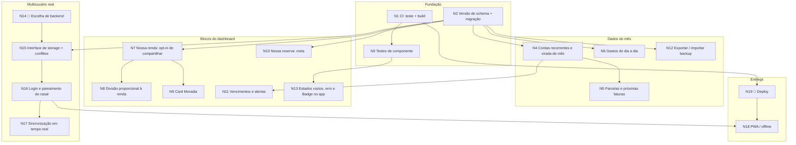

# Duo Finn — Próximos passos (grafo de tarefas)

Documento de handoff para um agente construir. Cada nó é uma tarefa fechada, com dependências,
arquivos, passos e critério de aceite. Uma seta `A --> B` significa "B só começa depois de A pronto".

## Como usar

1. Leia **Contexto** e **Regras invioláveis** antes de qualquer nó.
2. Pegue um nó da **fronteira** (todas as dependências concluídas). Nós sem seta entre si podem ser feitos em paralelo.
3. Um nó = um PR pequeno contra `main`. Ao concluir, marque `[x]` na tabela de status deste arquivo, no mesmo PR.
4. Nós marcados 🧑 exigem uma decisão humana antes de codar: pergunte, não escolha sozinho.
5. Nó só está pronto quando `npm test` e `npm run build` passam **e** o fluxo foi conferido no navegador (desktop 1440px e celular 390px, tema claro e escuro).

## Contexto

- App React 18 + Vite + Tailwind + Recharts, sem backend. Ver `README.md`.
- Dados em dois escopos (`src/lib/storage.js`): `duofinn:shared:<mês>` (contas da casa, nomes) e
  `duofinn:personal:<pessoa>:<mês>` (renda e contas pessoais). Sessão (`duofinn:session`): usuário atual, mês, tema, modo.
- Cálculo em `src/lib/finance.js` (puro, testado em `src/lib/finance.test.js`).
- Telas em `src/components/views/`, primitivos em `src/components/ui/`, estado e ações em `src/App.jsx`.
- Design system: `docs/design-system.md` + página viva em `src/components/views/DesignSystem.jsx`.
- Modos: `duo` (casal) e `solo` (só eu — contas da casa ficam guardadas mas fora de todo cálculo).

## Regras invioláveis

- **R1 Privacidade por construção.** Nenhuma função de cálculo ou componente recebe dados pessoais do parceiro.
  O app só carrega o documento compartilhado + o pessoal de quem está olhando. Qualquer dado pessoal que passe a ser
  visível ao outro exige opt-in explícito de quem é dono (ver N7).
- **R2 A conta fecha igual para os dois.** Parte da casa e acerto derivam apenas do documento compartilhado.
  Todo cálculo novo sobre a casa precisa de teste provando que pessoa1 e pessoa2 chegam ao mesmo número.
- **R3 Só tokens.** Nada de hex solto nem classe Tailwind montada por string. Componente novo entra na página do
  design system e, se criar token, na tabela de contraste do `docs/design-system.md` (mínimo 4,5:1 para texto).
- **R4 Modo solo.** Toda tela/bloco novo define o que acontece em `solo` (esconder ou adaptar o texto).
- **R5 Dinheiro.** Arredondar com `round2`; soma das partes = total (sem perder centavo); valores em `whitespace-nowrap`.
- **R6 Texto** em pt-BR, segunda pessoa, botões dizem o que acontece.
- **R7 Migração.** Mudou o formato salvo? Suba `schemaVersion` e migre na leitura; nunca apague dado do usuário.
- **R8** Não usar Inter, logos de bancos reais nem marca/ilustração do Visor.

## Grafo

**Fronteira atual (podem começar já, em paralelo):** N3, N4, N6, N7, N10, N12, e as decisões N14 e N19.
**Caminho crítico para uso real por duas pessoas:** N2 → N15 → N16 → N17 (com N14 decidido).
**Maior valor sem backend:** N2 → N4 → N5 / N11.

## Status

| Nó | Tarefa | Depende de | Tamanho | Feito |
| --- | --- | --- | --- | --- |
| N1 | CI: teste + build | — | P | [x] |
| N2 | Versão de schema + migração | — | P | [x] |
| N3 | Testes de componente | N1 | M | [ ] |
| N4 | Contas recorrentes e virada de mês | N2 | M | [ ] |
| N5 | Parcelas e próximas faturas | N4 | M | [ ] |
| N6 | Gastos do dia a dia | N2 | M | [ ] |
| N7 | Nossa renda (opt-in) | N2 | M | [ ] |
| N8 | Divisão proporcional à renda | N7 | P | [ ] |
| N9 | Card Moradia | N7 | P | [ ] |
| N10 | Nossa reserva (meta) | N2 | M | [ ] |
| N11 | Vencimentos e alertas | N4 | M | [ ] |
| N12 | Exportar / importar backup | N2 | P | [ ] |
| N13 | Estados vazios, erro e Badge no app | N3 | P | [ ] |
| N14 | 🧑 Escolha de backend | — | decisão | [ ] |
| N15 | Interface de storage + conflitos | N2, N14 | G | [ ] |
| N16 | Login e pareamento do casal | N15 | G | [ ] |
| N17 | Sincronização em tempo real | N16 | M | [ ] |
| N18 | PWA / offline | N16, N19 | M | [ ] |
| N19 | 🧑 Deploy | N1 | P | [ ] |

Tamanho: P ≈ até meio dia, M ≈ um dia, G ≈ vários dias.

## Nós

### N1 — CI: teste + build
- **Por quê:** o repositório não tem CI; o PR não valida nada sozinho.
- **Arquivos:** `.github/workflows/ci.yml`.
- **Passos:** workflow em `pull_request` e `push` para `main`: Node 22, `npm ci`, `npm test`, `npm run build`.
- **Aceite:** check verde no PR; quebrar um teste de propósito deixa o check vermelho (reverter depois).

### N2 — Versão de schema + migração
- **Por quê:** N4, N6, N7, N10 mudam o formato salvo; hoje não há versão nem migração (R7).
- **Arquivos:** `src/lib/storage.js`, novo `src/lib/migrations.js`, testes.
- **Passos:** `schemaVersion: 1` nos documentos shared/personal/session; `migrate(doc, kind)` aplicado em toda leitura
  (documento sem versão = v0 → v1); gravar de volta já migrado.
- **Aceite:** teste carregando um documento v0 (formato atual) e obtendo v1 sem perder campo; app abre com dados antigos do localStorage.

### N3 — Testes de componente
- **Arquivos:** `vite.config.js` (ambiente jsdom), `src/**/*.test.jsx`; dev-deps `@testing-library/react`, `jsdom`.
- **Passos:** cobrir: (a) pessoa2 não vê conta pessoal da pessoa1 na tela; (b) adicionar conta pelo modal altera o saldo;
  (c) alternar `solo` esconde divisão/privacidade e restaura ao voltar; (d) marcar conta como paga.
- **Aceite:** os quatro cenários passam no CI, com um backend de storage em memória (sem depender de localStorage real).

### N4 — Contas recorrentes e virada de mês
- **Por quê:** meses fora de dez/2026 começam vazios; o usuário teria de recadastrar tudo.
- **Modelo:** `recurring: true` na conta (padrão ligado para moradia/contas fixas/reserva).
- **Arquivos:** `storage.js` (`load`), `AddTransactionModal.jsx` (chave "Repete todo mês"), `finance.js` se preciso.
- **Passos:** ao abrir um mês sem documento, copiar do mês anterior mais próximo as contas `recurring` (shared e personal,
  cada uma no seu escopo), com `paid: false` e novos ids estáveis (`<idOrigem>@<mês>`); não copiar `settled`.
- **Cuidado (R1):** a cópia do pessoal só acontece para quem está olhando; a do parceiro acontece quando ele abrir o mês.
- **Aceite:** ir para jan/2027 mostra aluguel etc. em aberto; voltar a dezembro não mudou nada; teste cobrindo a cópia e
  provando que não duplica ao abrir o mês duas vezes.

### N5 — Parcelas e próximas faturas
- **Depende de:** N4 (precisa de dados em meses futuros).
- **Modelo:** conta de cartão com `installments: { current, total }`; projeção = recorrentes + parcelas restantes.
- **Arquivos:** `finance.js` (`projectInvoices(months)`), `views/Cards.jsx`, modal.
- **UI:** bloco "Próximas faturas" na aba Cartões: 3 colunas (mês atual + 2), valor previsto, linha tracejada ligando os pontos.
- **Aceite:** parcela 2/5 aparece nos 3 meses seguintes e some depois da 5ª; teste da projeção; em `solo` mostra só os cartões pessoais.

### N6 — Gastos do dia a dia
- **Por quê:** hoje só existem contas com vencimento; falta gasto variável (mercado, transporte).
- **Modelo:** `expenses: [{ id, name, amount, date, category }]` no documento pessoal e no compartilhado (com `split`/`paidBy`).
- **Arquivos:** `finance.js` (entra em `myPersonal` / casa), `OverviewCards.jsx` (segmento "Dia a dia" na barra do saldo),
  `views/Flow.jsx` (saída na data real), modal (aba "Gasto").
- **Aceite:** lançar um gasto reduz a sobra e aparece no dia certo do gráfico; gasto da casa entra no acerto (teste R2);
  cor do novo segmento vira token documentado (R3).

### N7 — Nossa renda: opt-in de compartilhar
- **Por quê:** N8 e N9 precisam da renda do casal, mas renda é privada (R1).
- **Modelo:** no documento compartilhado, `sharedIncome: { pessoa1?: number, pessoa2?: number }`, escrito **só pelo dono** quando
  ele liga "Compartilhar minha renda com <parceiro>". Desligar remove o valor.
- **Arquivos:** `views/House.jsx` (card "Nossa renda"), `App.jsx` (ação), `storage.js`.
- **UI:** cada pessoa vê o próprio valor + chave; a do parceiro aparece como valor (se ele compartilhou) ou "privado" com cadeado.
- **Aceite:** com a chave desligada, o valor não existe em nenhum dado legível pelo parceiro (teste inspecionando o documento
  compartilhado); editar o salário com a chave ligada atualiza o valor compartilhado.

### N8 — Divisão proporcional à renda
- **Depende de:** N7.
- **Arquivos:** `finance.js` (`parseSplit` aceita `"proporcional"` + rendas compartilhadas), modal (opção no seletor), `splitLabel`.
- **Regra:** só disponível se os dois compartilharam a renda; se um desligar depois, a conta cai para 50/50 e mostra aviso (`Badge warn`).
- **Aceite:** 28k/22k → 56/44; testes de R2 e de centavos (R5); opção desabilitada com explicação quando falta renda.

### N9 — Card Moradia
- **Depende de:** N7 (para o modo "Salário do casal").
- **Arquivos:** novo componente em `OverviewCards.jsx`, `views/Overview.jsx`.
- **UI:** quanto a categoria `moradia` pesa no salário, barra com marcador de referência em 30%, alternância
  "Só meu salário / Salário do casal" (a segunda só habilita com as duas rendas compartilhadas), lista "o que entra na conta".
- **Aceite:** percentuais batem com cálculo manual em teste; em `solo` não há alternância.

### N10 — Nossa reserva (meta)
- **Modelo:** no compartilhado, `goals: [{ id, name, target, saved }]`; marcar a conta de categoria `reserva` como paga soma em `saved`
  (e desmarcar subtrai).
- **Arquivos:** nova aba ou card em `views/House.jsx`, `finance.js`.
- **Aceite:** progresso e previsão ("faltam N meses no ritmo atual") testados; em `solo` vira meta pessoal no documento pessoal.

### N11 — Vencimentos e alertas
- **Depende de:** N4 (precisa do mês corrente real com dados).
- **Arquivos:** `finance.js` (`dueStatus(account, today)` → `atrasada | hoje | em N dias | ok`), `AccountsList.jsx` (Badge),
  cabeçalho (sino com contador e lista).
- **Regra:** só para o mês corrente; meses passados/futuros não alertam. `today` é parâmetro (testável).
- **Aceite:** testes de borda (dia 31 em mês de 30, virada de mês); sino lista apenas contas visíveis para quem olha (R1).

### N12 — Exportar / importar backup
- **Arquivos:** `storage.js`, card "Dados" em `views/House.jsx`.
- **Passos:** exportar JSON com o compartilhado + **apenas o pessoal de quem exporta**, de todos os meses; importar valida
  `schemaVersion`, migra e pede confirmação antes de sobrescrever.
- **Aceite:** exportar → restaurar exemplo → importar devolve o estado idêntico (teste de ida e volta); arquivo inválido mostra erro, não quebra.

### N13 — Estados vazios, erro e Badge no app
- **Arquivos:** views e `AccountsList.jsx`.
- **Passos:** usar `Badge`/`Eyebrow` (hoje só na página do design system) nos status de conta e cartão; estado vazio com ação em
  cada tela; falha de leitura/gravação do storage mostra aviso em vez de tela em branco.
- **Aceite:** mês vazio em todas as abas tem mensagem + botão; simular erro do storage em teste de componente.

### N14 — 🧑 Escolha de backend (decisão)
- **Pergunta ao dono do produto:** onde os dados vão morar para duas pessoas em aparelhos diferentes?
- **Opções a apresentar:** (a) Supabase — Postgres + auth + RLS + realtime, menor esforço; (b) Firebase — Firestore + regras + auth;
  (c) backend próprio. Critério central: R1 tem de ser garantida **no servidor** (regra de acesso por dono), não só na interface.
- **Saída:** opção escolhida registrada neste arquivo. Sem isso, N15 pode ser feito só até a interface.

### N15 — Interface de storage + conflitos
- **Por quê:** hoje o documento compartilhado é gravado inteiro (última gravação vence): duas pessoas editando ao mesmo tempo perdem dados.
- **Arquivos:** `storage.js` → `src/lib/storage/` com `interface` + adaptadores `local`, `claude` (`window.storage`) e o do backend escolhido.
- **Passos:** operações por item (`upsertAccount`, `removeAccount`, `setPaid`…) em vez de salvar o documento todo; `updatedAt` por item;
  merge por item na leitura. Validar também o caminho `window.storage` dentro de um Artifact (nunca foi exercitado).
- **Aceite:** teste simulando dois clientes: A edita o aluguel e B adiciona a luz "ao mesmo tempo" → as duas mudanças sobrevivem;
  suíte de contrato única rodando contra todos os adaptadores.

### N16 — Login e pareamento do casal
- **Passos:** autenticação; criar "casa" e convidar o parceiro por link/código; regras de acesso no servidor: compartilhado legível
  pelos dois membros, pessoal só pelo dono. Remover "Ver como" quando autenticado (fica só no modo demonstração local).
- **Aceite:** teste de integração tentando ler o pessoal do outro com a credencial errada → negado pelo servidor; migração dos
  dados locais existentes para a conta no primeiro login (R7).

### N17 — Sincronização em tempo real
- **Passos:** assinar mudanças do compartilhado; atualizar a tela sem recarregar; indicador discreto "atualizado agora por <nome>".
- **Aceite:** em duas janelas, marcar o aluguel como pago em uma reflete na outra em poucos segundos, sem perder edição em andamento no modal.

### N18 — PWA / offline
- **Passos:** manifest, ícones próprios, service worker com cache do app; fila de gravações offline reenviada ao reconectar (usa o merge do N15).
- **Aceite:** instalável no celular; abre sem rede com os últimos dados; edição offline sincroniza ao voltar.

### N19 — 🧑 Deploy
- **Pergunta:** onde publicar (Vercel, Netlify, GitHub Pages) e com qual domínio?
- **Passos:** pipeline de deploy a partir da `main` depois do CI verde; preview por PR se a plataforma oferecer.
- **Aceite:** URL pública servindo o build da `main`; README com o link.

## Fora de escopo por enquanto

Ilustrações 3D do mock (não há assets), integração bancária/Open Finance, mais de duas pessoas por casa, multi-moeda.
